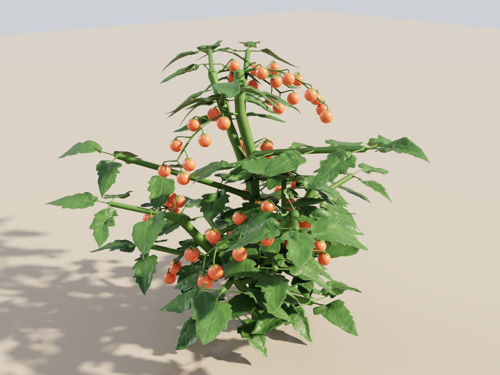
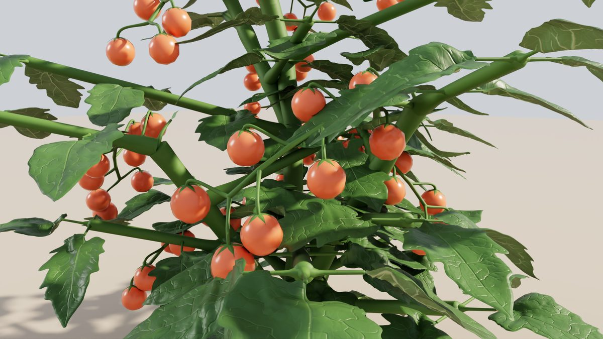
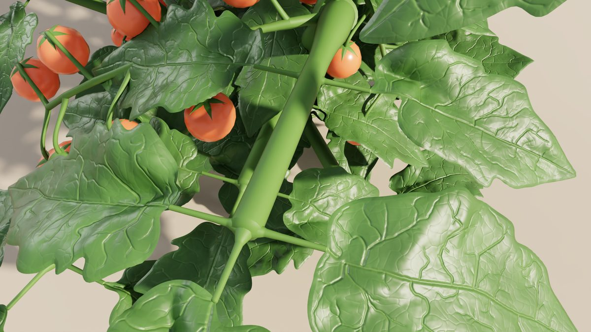
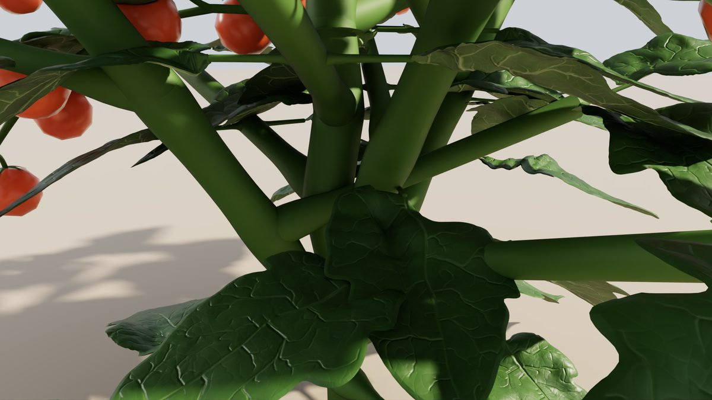
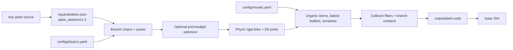

# AutoTom Digital Twin

[](https://www.python.org/)
[](https://openusd.org/)
[](https://developer.nvidia.com/isaac-sim)
[](https://github.com/astral-sh/uv)

AutoTom Digital Twin turns a tomato plant skeleton into an articulated
OpenUSD plant for NVIDIA Isaac Sim: rigid links joined by bending joints,
organic stems, realistic 3D leaflets and tomatoes that can be pushed and
dragged.

The input is a simple graph of segments (`plant_skeleton/1.0`). Any source
that can describe a plant as segments can feed it: a growth model, a
reconstruction from images or scans, or a hand-written file.



| Trusses | Leaflets | Stems |
| --- | --- | --- |
|  |  |  |

The default `input/skeleton.json` with the default `config/` files, path-traced in
Isaac Sim after 3 s of gravity.

## Quick start

```bash
git clone https://github.com/aledevv/isaacsim-tomato-plant
cd autotom_digital_twin
./run_main.sh                    # input/skeleton.json -> output/plant.usda -> Isaac Sim
./run_main.sh --generate-only    # only write the USDA (no Isaac Sim needed)
./run_main.sh --headless         # short physics check without the GUI
./run_main.sh --input input/examples/tomato_day50.json --generate-only
```

### Installation options

`run_main.sh` uses [uv](https://github.com/astral-sh/uv) when it is installed,
so the commands above need nothing else. All routes install the same pinned
versions from `uv.lock`; details and the Isaac Sim setup are in
[`docs/INSTALL.md`](docs/INSTALL.md).

| Route | Setup |
| --- | --- |
| uv (recommended) | Install uv, then `./run_main.sh` |
| venv + pip | `pip install -r requirements.txt && pip install --no-deps -e .` in a Python 3.14 venv |
| conda | `conda env create -f environment.yml` |
| Docker | `docker build -t autotom .` (exporter) or `--target isaac` (with Isaac Sim) |

| File | Role |
| --- | --- |
| `input/skeleton.json` | The plant (a 160-day dwarf tomato by default). Format: [`src/plant_skeleton/README.md`](src/plant_skeleton/README.md) |
| `input/examples/` | `small_plant.json` (smallest hand-written example) and the same tomato at days 10, 25 and 50 |
| `config/physics.yaml` | Stiffness, damping, masses, joints, fruits, collisions, scale; every option commented |
| `config/visuals.yaml` | Mesh density, leaflets, stem colour, decorations, pose; every option commented |
| `output/plant.usda` | Generated scene plus `plant.manifest.json` (not tracked) |

## Leaflets

By default every leaflet is a baked 3D leaf (outline, veins and bend from
[tomato-leaf-gen](https://github.com/aledevv/tomato-leaf-gen)) loaded as a
plain USD asset, so neither the exporter nor Isaac Sim needs extra packages.
The 131 leaves in `assets/leaves/default/` give one unique leaf per leaflet to
any plant with up to 131 leaflets, the default plant included; a larger plant
reuses them. Details: [`src/exporterV2/docs/11_baked_leaf_assets.md`](src/exporterV2/docs/11_baked_leaf_assets.md).

## Pipeline



1. The skeleton has one node per straight segment (stem, branch, petiole,
   leaf rachis, truss rachis, pedicel), plus leaflets and fruits.
2. The exporter groups nodes into branches and gives each node one rigid link
   with capsule colliders and a D6 joint whose drive comes from the segment's
   Young's modulus (50.64 MPa for stems and leaves, Gao et al. 2024), radius
   and length.
3. Above about 220 joints the optimizer can lock or merge the least important
   ones.
4. Organic meshes, leaflets, curved pedicels and ripeness-coloured tomato
   spheres are added as visuals; physics never depends on them.
5. Colliders overlapping at rest are filtered, distant branches are allowed to
   touch each other, scene settings are written, and a manifest records
   counts, poses and masses.

The full description is in [`src/exporterV2/README.md`](src/exporterV2/README.md).

## Repository layout

```text
.
├── input/                          # skeleton.json (default input) and examples/
├── config/                         # physics.yaml, visuals.yaml (commented defaults)
├── output/                         # generated USDA + manifest (not tracked)
├── assets/leaves/default/          # 131 baked 3D leaflets
├── data/simulation_output/         # CSV fixtures for the joint-optimizer tests
├── docs/                           # developer, install and coding-agent guides; images/ for this README
├── run_main.sh                     # build the plant and open it in Isaac Sim
└── src/
    ├── plant_skeleton/             # input format: model, JSON I/O, validation
    └── exporterV2/                 # exporter, mesh generators, Isaac Sim launcher
```

## Features

| Category | Feature |
| --- | --- |
| Input | Generic `plant_skeleton/1.0` graph of segments |
| Configuration | Commented YAML for physics and visuals; defaults ready to use |
| Geometry | Stem, side shoots, compound leaves, trusses, pedicels, tomatoes |
| Visuals | Organic segmented stems with taper, root flare and junction bulge |
| Visuals | Baked 3D leaflets with veins, one per leaflet, hanging below their stalk |
| Visuals | Gravity-curved pedicels, calyces, decorative terminal forks (switchable) |
| Materials | Shared PBR materials; tomato colour from ripeness |
| Physics | Articulated rigid links with PhysX D6 drives |
| Fruits | None, visual (default) or physical with breakable joints (experimental) |
| Collision | Branch-branch contacts; pairwise filter for colliders touching at rest |
| Optimization | Joint-budget lock/merge for large plants |
| Runtime | Isaac Sim launcher with interactive drag tools and headless check |

## Testing

Run the suite by hand before merging:

```bash
uv run pytest -q \
  src/plant_skeleton/tests \
  src/exporterV2/tests \
  src/exporterV2/core/optimizations/tests \
  src/exporterV2/core/skinning/tests \
  src/exporterV2/legacy_csv/tests
uv run pytest -q src/exporterV2/core/usd/tests
```

`src/exporterV2/tests/test_exporter.py` locks the default plant to a
reference set of bodies, joints, poses, masses and drive gains.
Interaction in the Isaac Sim GUI is checked by hand with `./run_main.sh`.

## Documentation

- [`docs/DEVELOPER_GUIDE.md`](docs/DEVELOPER_GUIDE.md): ten-minute tour for new developers (start here).
- [`docs/INSTALL.md`](docs/INSTALL.md): uv, venv + pip, conda and Docker setups.
- [`docs/AGENTS_GUIDE.md`](docs/AGENTS_GUIDE.md): code map, checks and rules for coding agents.
- [`src/plant_skeleton/README.md`](src/plant_skeleton/README.md): input format, and how to convert another source into it.
- [`src/exporterV2/README.md`](src/exporterV2/README.md): pipeline, folder map, what to edit.
- [`src/exporterV2/visuals/README.md`](src/exporterV2/visuals/README.md): where every mesh generator lives.
- `src/exporterV2/docs/`: physics, collisions, segmented visuals, leaflets, troubleshooting.
- `src/exporterV2/core/optimizations/docs/`: joint-budget optimizer.

## Notes for reproducibility

- The same skeleton and configuration give the same USDA: leaflet assets,
  droop angles, terminal forks and pedicel curves are keyed from segment ids
  and `leaves.seed`.
- Material parameters are appearance settings tuned for Isaac Sim rendering,
  not measured optical constants.
- Physics parameters other than the Young's modulus are not calibrated on a
  real plant.

## Data and credits

The baked leaflets come from [tomato-leaf-gen](https://github.com/aledevv/tomato-leaf-gen),
whose models are learned from the tomato leaflet photos of Chitwood et al. (2013, 2014;
[Zenodo, CC BY 4.0](https://zenodo.org/records/19656245)) for outlines and veins, and
from the Pheno4D scans (Schunck et al. 2021) for the bend. Please cite them as well when
you use the leaflets. The branch Young's modulus (50.64 MPa) is from Gao et al. (2024).
